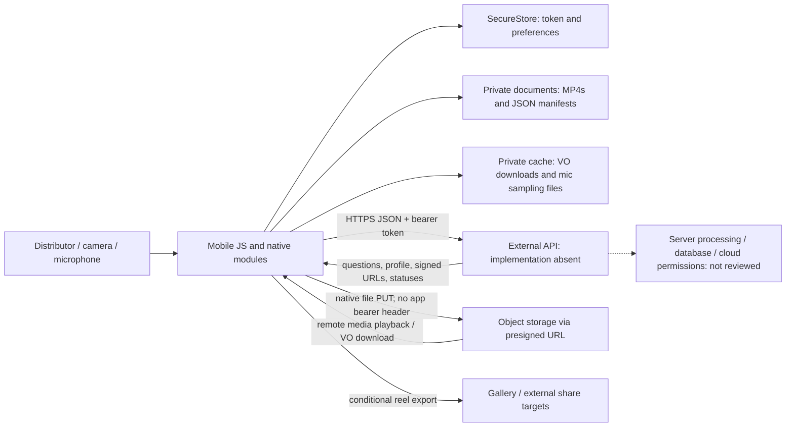

# Security and quality audit

Date: 2026-10-01. Repository: `C:\dev\video-testimonial`. Audited HEAD: `65375b2dd8d702854b53639133663ab4decb2fc1`.

## Executive summary

- **Overall risk: High for an external distributor rollout.** Four verified High findings affect account privacy, intentional recording, truthful recording status, and recovery of unsent work.
- This checkout is the **mobile application**, not the Express/Prisma/worker example in the supplied audit template. Backend security cannot be certified from it.
- Local recordings and session metadata are not partitioned by account; another signed-in distributor can view and submit the previous person's footage.
- Rehearsal can start a real recording automatically, and a failed recorder start can leave the UI claiming that recording is underway.
- An offline or unauthenticated cold start overwrites the saved recording manifest with empty state. The MP4s remain, but the app loses access to that work.
- Additional verified defects affect question identity, take selection, offline playback, background transfers, audio checks, and trim metadata.
- TypeScript passes. No repository test suite, lint setup, or CI checks were found. Mocked, in-memory executions reproduced several important failures without touching real services or files.
- A live registry check found **31 distinct dependency advisories / 40 matching version-advisory entries across nine transitive package names**. Reviewed dependency paths are build tooling; these are not 31 demonstrated mobile exploits.
- No Critical finding was substantiated. Known prototype limitations and deferred features are separated from new defects below. Source files were not changed.

## Scope, architecture, and corrected context

### What is actually present

`index.ts` registers `App.tsx`; providers wrap a custom, approximately 1,990-line `AppFlow.tsx` state machine. There is no navigation library. The app authenticates distributors, fetches a client-configured question set, obtains local consent, requests camera/microphone permissions, guides framing, records individual answers, retains multiple takes, collects trim metadata, and uploads selected takes in a manually confirmed batch.

The implemented stack is Expo **57.0.2**, React **19.2.3**, React Native **0.86.0**, TypeScript **6.0.3**, VisionCamera **5.1.0**, face detector **2.0.2**, and worklets **0.10.0**. The face-detector patch is applied through `patch-package` **8.0.1**. Expo FileSystem, Audio, and Video are **57.0.0**; SecureStore is **57.0.1**; MediaLibrary is **57.0.3**; background-actions is **4.1.0**. Direct installed versions match the lockfile. All 15 direct dependencies covered by the installed Expo `bundledNativeModules.json` satisfy that SDK's expected ranges.

The question count is dynamic, not invariably five. Questions and pre-generated voice-over URLs come from the API. Face **bounding boxes**, not enabled landmarks, currently drive centering/distance/headroom. Recorded MP4s move into app-private documents; session/question/sync manifests are ordinary JSON files. JWTs and preferences use SecureStore. Upload uses native `File.upload()` to an API-provided presigned URL, then API confirmation. Progress is checkpointed by completed question, not byte offset. Android uses a foreground-service keepalive; iOS native upload uses background URLSession semantics, which do not themselves restore the whole JS confirm sequence after termination.

The API contract describes **S3**, while AGENTS.md describes **R2**. The client accepts a presigned URL and does not prove which provider is deployed. Likewise, server STT, sentiment models, rendering, IAM, database schema, queues, and deployment topology cannot be established from this checkout. No Express, Prisma, backend route handlers, migrations, PM2/Caddy configuration, or dashboard source are present. Reel rendering is default-disabled by the mobile flag; no local rendering flag was set in the inspected environment file. Self-registration is explicitly an internal-testing feature. The local API URL uses HTTPS; its value was not printed or contacted.

Generated `android/` exists locally but is ignored. No generated iOS project was available. `app.json`, Babel config, and `plugins/withBackgroundUploadService.js` are the reproducible configuration sources. There is no tracked EAS deployment config or CI workflow. The generated Android manifest has Expo Updates disabled. No implemented invitation deep-link handler exists.

### Trust boundaries



Untrusted inputs include login/register fields, camera/mic data, remote JSON, media, and URLs; cached JSON also needs validation after partial writes or version changes. **A valid identity changing on the same device is a separate trust boundary** that the current media/session design fails to enforce. Backend responses are statically typed using unchecked casts, not runtime-validated. Build-time `EXPO_PUBLIC_*` values are public bundle data; the inspected keys were URL/feature flags, not service credentials. Presigned URLs are temporary bearer capabilities and should not become permanent public share links. See [Expo environment-variable guidance](https://docs.expo.dev/guides/environment-variables/) and [AWS presigned URL guidance](https://docs.aws.amazon.com/AmazonS3/latest/userguide/using-presigned-url.html).

## Findings

Severity reflects this app's actual exposure, including its Android-phone focus and disabled reel feature. **Verified** means the path was established from source, installed SDK implementation, and/or an in-memory reproduction; it does not mean a physical-device or production exploit was executed. **Likely** identifies a supported failure mechanism whose fault timing was not exercised. Effort: S = localized change; M = coordinated changes and regression checks; L = protocol/platform work.

| ID | Title | Severity | Confidence | Area | Primary evidence |
|---|---|---|---|---|---|
| F01 | Recordings cross account boundaries | High | Verified | A/C | `AppFlow.tsx:1363`, `session.ts:23` |
| F02 | Rehearsal can start real recording | High | Verified | A/B/F | `AppFlow.tsx:1894` |
| F03 | Failed recorder start displays a false recording state | High | Verified | B/F | `AppFlow.tsx:1014` |
| F04 | Unauthenticated/offline startup overwrites unsent progress | High | Verified | B/C/F | `AppFlow.tsx:484`, `AppFlow.tsx:629` |
| F05 | Refreshed question order reassigns existing footage | Medium | Verified | B/C/E | `upload.ts:54` |
| F06 | Take selection changes upload but not visible selection | Medium | Verified | B/G | `AppFlow.tsx:979`, `AppFlow.tsx:1203` |
| F07 | Timestamp cache falsely certifies stale local media | Medium | Verified | B/C | `myVideos.ts:84` |
| F08 | Offline My Videos hides locally available recordings | Medium | Verified | B/F | `AppFlow.tsx:872`, `screens/MyVideosScreen.tsx:108` |
| F09 | Later upload batches lose Android foreground protection | Medium | Verified | B/F | `AppFlow.tsx:830` |
| F10 | Failed VO downloads can become preferred partial files | Medium | Verified | B/C/F | `voCache.ts:43`, `voCache.ts:94` |
| F11 | Sole session checkpoint is not written atomically | Medium | Likely | B/C | `session.ts:60` |
| F12 | Question audio is bounded by countdown rather than completion | Medium | Verified | B/E/F | `screens/CameraCheckScreen.tsx:105` |
| F13 | Trim shortcut can send an empty interval | Medium | Verified | B/E | `screens/ReviewTrimScreen.tsx:102` |
| F14 | Noise gate accepts unmeasured audio; iOS sampler stays disabled | Medium | Verified | B/F | `CameraAlignment.tsx:215`, `useAmbientNoiseCheck.ts:105` |
| F15 | Ambient sampling leaves incidental microphone recordings | Medium | Verified | A/C/D | `useAmbientNoiseCheck.ts:32`, `useAmbientNoiseCheck.ts:69` |
| F16 | Next-question navigation assumes answers form a prefix | Medium | Verified | B | `AppFlow.tsx:1290` |
| F17 | SecureStore rejection leaves startup on an endless spinner | Medium | Verified | B/F | `AppFlow.tsx:482` |
| F18 | Alignment constraints cannot be satisfied on wide tablets | Low | Verified | B/F | `alignment.ts:12`, `alignment.ts:44` |
| F19 | Disabled reel feature contains broken save/share paths | Low | Verified | E/F | `screens/VideoPlayerScreen.tsx:49`, `screens/VideoPlayerScreen.tsx:63` |
| F20 | Locked build tooling has known dependency advisories | Low | Verified version matches | A/H | `package-lock.json:1978`, `package-lock.json:5573` |
| F21 | Custom switches lack accessible names and checked state | Low | Verified structure | F/G | `components/ui/Toggle.tsx:29` |
| F22 | Trim drag coordinates use the wrong origin | Low | Verified | B/F | `screens/ReviewTrimScreen.tsx:272` |

### High

#### F01 — Recordings cross account boundaries

**High / Verified / M.** [Logout implementation](C:/dev/video-testimonial/AppFlow.tsx:1363):

```ts
function handleLogout() {
  logout();
  setDistributorId(null);
  setDistributorProfile(null);
  setMainTab('home');
  setScreen('login');
}
```

`videos`, pending takes, questions, answer rows, and upload state remain. `handleAuthenticated()` at `AppFlow.tsx:1399–1417` never detaches or replaces them. [Session persistence](C:/dev/video-testimonial/session.ts:23) has no client/distributor owner and writes a single `session-state.json`; restoration performs `setVideos(stored.videos)` at `AppFlow.tsx:514`. My Videos merges retained local footage even when the current account has no server segments (`AppFlow.tsx:898–911`). Upload requests use the current token (`api.ts:67–68`, `upload.ts:60–69`).

**Scenario:** A records an unsent take, logs out, and B signs in on the shared device. B can watch A's take and explicitly submit those bytes using B's own authorized upload URL. This needs no server IDOR or token forgery. Preserving files on logout is an intentional choice; exposing them to another account is not a necessary consequence.

**Related consequences:** an unconsented B can inherit meaningful A progress: persist B's onboarding as `main` (`AppFlow.tsx:610–643`), restart, and the meaningful-progress restore path (`504–575`) bypasses the consent check used only in the no-progress branch. Outstanding profile/question callbacks are not identity-bound. A late old-token 401 still invokes the current expiry handler (`api.ts:95–96`); an in-memory reproduction confirmed that stale response can expire a newer session. An active upload also retains old media while reading mutable auth for later requests; exact server acceptance of that race is unverified and is not needed for the main finding.

**Fix:** namespace local manifests/media/caches by `{clientId, distributorId}`; detach all account state on logout and invalidate old async work using an auth generation. Authorize each upload against its immutable owner. Restore only the authenticated owner's data. Quarantine legacy ownerless sessions instead of assigning them to the next login. Enforce consent independently before every restore into record/upload-capable screens. Handle credential deletion failures rather than ignoring the logout promise.

**Verification:** A → logout → B, including process restart and delayed requests: B sees/submits no A media or questions; returning to A recovers A's work. New B cannot bypass consent. Old requests cannot mutate B. [OWASP session-termination data exposure](https://mas.owasp.org/MASWE/MASVS-AUTH/MASWE-0024/).

#### F02 — Rehearsal can start real recording

**High / Verified / S.** [Shared camera callback](C:/dev/video-testimonial/AppFlow.tsx:1894):

```tsx
onLocked={() => {
  setChecksReady(true);
  if (autoStart) setPhase('countdown');
}}
alignmentActive
```

Auto-start defaults to true (`AppFlow.tsx:308`). Rehearse sets `phase='rehearse'` (`1764`) but mounts this same active alignment component. Its lock callback fires when checks pass (`CameraAlignment.tsx:275–281`). Countdown completion starts the real recorder (`AppFlow.tsx:1015–1018`), and normal finish persists a take (`1040–1093`). `screens/RehearseScreen.tsx:23–26` and `DECISIONS.md:160` explicitly promise no saved rehearsal.

**Scenario:** choose Rehearse and stand in position. The app advances into countdown and records without “Record for real.” The transition is visible and the take is **not automatically uploaded**, but recording was not the action requested.

**Fix:** permit lock-driven advancement only in `cameraCheck`. Separate passive rehearsal preview from recording gates; “Record for real” must initiate a fresh check. **Verification:** invoke the mocked camera's lock callback during rehearsal, with both auto-start values and the rehearsal popup open; no countdown/recorder call is allowed. Normal camera-check auto-start must still work. [VisionCamera v5 recorder API](https://visioncamera.margelo.com/api/react-native-vision-camera/hybrid-objects/Recorder).

#### F03 — Failed recorder start displays a false recording state

**High / Verified / M.** [Countdown completion](C:/dev/video-testimonial/AppFlow.tsx:1014):

```ts
recordingStartedAtRef.current = Date.now();
cameraRef.current
  ?.startRecording()
  .catch((error) => console.error('[recording] start failed', error));
setPhase('recording');
```

`CameraAlignment.tsx:402–413` awaits recorder creation and start. Installed VisionCamera **5.1.0** Android code at `node_modules/react-native-vision-camera/android/src/main/java/com/margelo/nitro/camera/hybrids/recording/HybridVideoRecorder.kt:89–98` distinguishes startup rejection from runtime callback:

```kotlin
if (!didResolve) {
  promise.reject(error)
  didResolve = true
} else {
  onRecordingError(error)
}
```

**Scenario:** storage exhaustion or a pre-Start native failure rejects the promise. The UI already shows Recording and increments its independent timer (`AppFlow.tsx:984–990`). The person can answer while no video is being captured. Existing `handleRecordingError()` recovery does not run because it is only wired to the callback. Stop failures are also only logged (`1939–1941`); a null recorder simply has nothing to stop.

**Fix:** model starting/recording/stopping explicitly; require a real camera handle and successful native start before displaying recording state. Send rejected start/stop promises and native errors through one guarded recovery path. Protect against duplicate finish taps and late completion after exit. **Verification:** separately reject creation, pre-start, and stop without firing the runtime callback; never show a false active recording; preserve previous takes and allow retry. Also test normal capture, callback errors, and exit during delayed start. [VisionCamera v5 recorder API](https://visioncamera.margelo.com/api/react-native-vision-camera/hybrid-objects/Recorder).

#### F04 — Unauthenticated/offline startup overwrites unsent progress

**High / Verified / M.** [Auth restore](C:/dev/video-testimonial/auth.ts:63) catches every `/me` error and returns null; `auth.ts:82–85` then deletes the stored token. [Startup](C:/dev/video-testimonial/AppFlow.tsx:484):

```ts
if (!auth) {
  setScreen(DEFAULT_UNAUTHENTICATED_SCREEN);
  setSessionRestored(true);
  return;
}
```

This returns before `loadSession()` at line 504. The persistence effect then runs with initial `videos=[]` and `takesByQuestion={}`:

```ts
// AppFlow.tsx:609–611,629–643 (excerpt)
if (!sessionRestored) return;
const persistedScreen: PersistedScreen =
  screen === 'question' || screen === 'uploading' ? screen : 'main';
saveSession({ /* ... */ videos, takesByQuestion, /* ... */ });
// session.ts:60
file.write(JSON.stringify({ ...state, version: SESSION_VERSION }));
```

**Scenario and reproduction:** launch with one unsent kept clip and one pending take. Actual-source, in-memory checks for **offline, HTTP 503, HTTP 401, and missing stored token** each produced zero reads of the old session and one write containing zero clips/pending groups. Fresh authentication still recovered zero clips because `handleAuthenticated()` (`1399–1417`) does not load the session. There is no durable-recordings directory recovery scan. **Video bytes are not deleted**; metadata and access through the app are lost.

**Fix:** separate “authentication check finished” from “owned recording state hydrated.” Never overwrite an unread manifest with defaults. Preserve credentials on transient transport/server failures; distinguish confirmed expiry. Preserve an owner's pending work while requiring reauthentication, then restore through a shared owner-aware hydration path. Coordinate with F01: offline recovery must not expose an unknown owner's files.

**Verification:** all four conditions above plus native storage failures must leave metadata/media intact; successful same-account login restores takes, trims, and completed-upload checkpoints. Another account must not see them. [Expo SecureStore behavior](https://docs.expo.dev/versions/latest/sdk/securestore/), [Android offline-first guidance](https://developer.android.com/topic/architecture/data-layer/offline-first).

### Medium

#### F05 — Refreshed question order reassigns existing footage

**Medium / Verified / M.** [Recorded take model](C:/dev/video-testimonial/recordings.ts:29) stores `questionIndex: number` as an array position. `questions.ts:7–8` correctly warns that `id` is stable while ordering is not. Refresh overwrites the list (`AppFlow.tsx:441–443`). [Upload](C:/dev/video-testimonial/upload.ts:54):

```ts
const question = questions[video.questionIndex];
// ... only checks that a question exists
const questionIndex = question.index;
```

**Scenario:** record A at position 0; a backend edit changes the list to `[B, A]`. The old A take is labeled and uploaded as B. Actual `uploadSegment` execution with mocked I/O sent B's index to both upload-url and confirm. Validating array bounds cannot detect this.

**Fix:** persist stable question ID and revision/snapshot on each take, resolve by ID, and reconcile removed/materially edited questions explicitly. Migrate legacy positional recordings only when their original mapping is known. **Verify:** reorder, insertion, removal, language refresh, and restart cannot silently relabel a take. [React state identity guidance](https://react.dev/learn/choosing-the-state-structure).

#### F06 — Take selection changes upload but not visible selection

**Medium / Verified / S.** [Primary selection](C:/dev/video-testimonial/AppFlow.tsx:1203) updates `videos`:

```ts
setVideos((prev) =>
  prev.map((v) => (v.questionIndex === qIndex ? { ...v, isPrimary: v.id === takeId } : v)),
);
```

`answerRows` are derived from those videos at `AppFlow.tsx:898–909`, but their effect only depends on `[screen, mainTab, myVideosRefreshToken]` (`979`). The card displays `answer.takes[0]` as primary (`screens/MyVideosScreen.tsx:288,337–342`).

**Scenario:** select B while A is primary. Upload sends B, but the visible selection and play action remain A until reopening the tab. **Fix:** retain remote records separately and derive the merged rows from current local takes/questions/server records; local selection must not require a network refetch. **Verify:** checkmark, preview, upload summary, and actual selected file all change together without leaving the tab. [React effect dependencies](https://react.dev/reference/react/useEffect).

#### F07 — Timestamp cache falsely certifies stale local media

**Medium / Verified / S–M.** [Cache implementation](C:/dev/video-testimonial/myVideos.ts:84):

```ts
const matches = cache[questionIndex] === updatedAt;
cache[questionIndex] = updatedAt;
writeCache(cache);
return matches;
```

`AppFlow.tsx:930–934` uses a match to select local bytes. Seeing a newer server timestamp updates this marker without replacing those bytes. **Scenario:** another device submits B while this device retains A. First refresh plays B remotely; the next refresh trusts unchanged A. In-memory actual-module results were `t1: false,true; t2: false,true`, with no file update.

**Fix:** bind server revision to a particular local file/take and update that association only after that file's confirmed upload or successful download. **Verify:** repeatedly refresh after a remote retake; stale local media must never become valid merely through repeated observation. [State consistency guidance](https://react.dev/learn/choosing-the-state-structure); retake/upsert and playback contract: `API_CONTRACT.md:262–282`.

#### F08 — Offline My Videos hides locally available recordings

**Medium / Verified / S.** [Row loading](C:/dev/video-testimonial/AppFlow.tsx:872) awaits `fetchSegments()` before constructing local rows. Failure sets an error (`964–968`). [Screen](C:/dev/video-testimonial/screens/MyVideosScreen.tsx:108):

```tsx
if (error) {
  return ( /* error message and Try again only */ );
}
```

**Scenario:** connectivity fails after recording; locally saved answers cannot be reviewed or retaken from My Videos despite their files being available. Even previously populated rows are hidden. **Fix:** construct local rows synchronously and show remote-refresh failure inline without blocking local actions. **Verify:** failed, slow, and absent network still allow local review/editing; remote results merge later. [Android offline-first reads](https://developer.android.com/topic/architecture/data-layer/offline-first).

#### F09 — Later batches lose Android foreground protection

**Medium / Verified / S.** [Service gate](C:/dev/video-testimonial/AppFlow.tsx:830):

```ts
const batchInFlight = uploadConfirmed && !hasSubmittedBatch && !uploadError;
```

The first success sets `hasSubmittedBatch=true` (`783`). Normal new-batch entry points reset confirmation/indices/error but never that historical flag (`1584–1598`, `1618–1623`). The confirmation screen already recognizes that the flag means “ever submitted” (`1671–1676`).

**Scenario:** submit Q1, later record Q2 through My Videos, and submit again. Upload runs without restarting its foreground service. Backgrounding loses the first batch's protection. This establishes absence of the service, not a guarantee of immediate OS termination. **Fix:** use a current-batch lifecycle/pending-take set for service ownership and cleanup. **Verify:** first, subsequent, failed/retried, and restored batches start/stop the service correctly. [Android dataSync service requirements](https://developer.android.com/develop/background-work/services/fgs/service-types#data-sync).

#### F10 — Failed VO downloads become preferred partial files

**Medium / Verified / S.** [Download](C:/dev/video-testimonial/voCache.ts:94) writes directly to the final file:

```ts
await File.downloadFileAsync(question.vo_playback_url, file, { idempotent: true });
// catch only logs
```

Resolution at `voCache.ts:43` is `return file.exists ? file.uri : null;`, and `AppFlow.tsx:1736` prefers it to remote audio. Installed FileSystem **57.0.0**, `src/File.ts:45–48`, documents partial Android destination files after failed downloads; Android `FileSystemDownload.kt:95–103` streams into the destination.

**Scenario:** connection drops mid-MP3; subsequent read-aloud selects truncated bytes. Updating an existing VO can also overwrite a good copy with a partial one. The actual cache module was executed against a mock of this documented failure: lookup still returned the partial file.

**Fix:** download to a unique temporary file, publish only after success, and require a matching completed revision marker when resolving local audio. Preserve the last good version on failure. **Verify:** first download and replacement download interrupted mid-stream; neither may publish partial audio. [Expo FileSystem download semantics](https://docs.expo.dev/versions/latest/sdk/filesystem/), cross-checked against installed 57.0.0 because the versioned FileSystem URL was unavailable.

#### F11 — Sole session checkpoint is not crash-atomic

**Medium / Likely / M.** [Checkpoint](C:/dev/video-testimonial/session.ts:60) directly executes `file.write(JSON.stringify(...))`; parse failure returns null at `67–71`. Many changes rewrite this sole manifest (`AppFlow.tsx:608–659`). Installed FileSystem Android `FileSystemFile.kt:82–83` uses an ordinary overwrite stream; iOS `FileSystemFile.swift:92` explicitly uses `atomically: false`.

**Scenario:** disk exhaustion/process termination during overwrite can leave a truncated manifest; next launch treats it as missing, losing the UI's references to durable clips. The vulnerable write mechanism is verified; fault timing was not exercised, hence Likely.

**Fix:** atomically replace a temporary manifest with recoverable last-good metadata; validate loaded structure and handle write failures without destroying old state. **Verify:** inject partial-write/final-replace failures and recover the previous committed manifest. This is separate from F04's deterministic overwrite of a perfectly healthy manifest. [Android AtomicFile principles](https://developer.android.com/reference/android/util/AtomicFile).

#### F12 — Question audio is cut to countdown length

**Medium / Verified / M; already acknowledged sequencing gap.** [VO effect](C:/dev/video-testimonial/screens/CameraCheckScreen.tsx:105) starts `player.play()` when `countingDown` becomes true and returns `safePause` for cleanup. `AppFlow.tsx:140–152,1002–1025` starts recording after a fixed five seconds plus 300 ms, without observing playback completion.

**Scenario:** an eight-second translated question or delayed streaming playback is interrupted when recording starts. Even a complete 5.1-second clip leaves almost no post-question preparation time. The locked sequence is full question → five-second countdown → recording. Actual mic bleed is device/timing-dependent and is not claimed as proven.

**Fix:** introduce explicit question-playback completion/error/skip before countdown; await audio/mic-sampler shutdown before native capture. **Verify:** long VO, delayed load, failed playback, VO disabled, and normal cached audio. [Expo SDK57 video playback events](https://docs.expo.dev/versions/v57.0.0/sdk/video/).

#### F13 — Trim shortcut can send an empty interval

**Medium / Verified / S for interval validation.** [Shortcut](C:/dev/video-testimonial/screens/ReviewTrimScreen.tsx:102):

```ts
onChangeTrim(start, next ? Math.max(start, selectedDuration - REMOVE_LAST_SECONDS) : selectedDuration);
```

`AppFlow.tsx:1119–1131` stores it without validation; `upload.ts:86–87` sends rounded milliseconds. Actual-function tests produced `[0,0]` for a 1.5-second clip and `[9,9]` for duration 10/start 9. `API_CONTRACT.md:227,258` explicitly requires end > start. Backend enforcement is contract-based, not a live test. A later whole-file retry cannot repair those values.

**Fix:** one validator across controls/restored state/upload enforcing a positive interval after rounding; disable or adjust the shortcut when insufficient footage remains. Verify short clips, late start handles, normal clips, and millisecond rounding.

**Related duration accuracy concern — Likely impact / M:** `AppFlow.tsx:1014,1042–1045` measures `Date.now()` from before native startup until after finalization/file movement, rather than encoded duration. Slow hardware can therefore produce a trim timeline longer than its actual video. Prefer encoded media metadata; retain elapsed time only for the visual timer. Do not blindly read VisionCamera's Android duration after stop, when native cleanup resets it. [Expo SDK57 video duration](https://docs.expo.dev/versions/v57.0.0/sdk/video/).

#### F14 — Noise gate accepts unmeasured audio; iOS sampling remains disabled

**Medium / Verified / M.** [Gate](C:/dev/video-testimonial/CameraAlignment.tsx:215):

```ts
const noiseReady = noise.status !== 'noisy' || noiseOverridden;
```

This admits `checking`. Rechecks require 20 good frames (`useAlignmentLock.ts:18`), approximately 667 ms at the documented 30 fps, while metering ignores its first 1,000 ms (`useAmbientNoiseCheck.ts:21,152`). Advancing disables sampling (`CameraAlignment.tsx:196–197,280`), so no classification is required.

Additionally, `useAmbientNoiseCheck.ts:103–107` prepares/records without setting Expo audio recording mode anywhere in app source. Installed Expo Audio **57.0.0** has `allowsRecording=false` at `ios/AudioModule.swift:13`, copies it to the recorder at `417`, and throws when false at `ios/AudioRecorder.swift:122–123`. VisionCamera's separate audio-session configuration does not set that Expo flag. The hook logs the failure and retains an unmeasured state that still passes the gate.

**Fix:** require a completed good sample or an explicit override; represent unavailable/error separately. Configure and restore iOS audio mode, measure warm-up from actual sampler start, and await shutdown before VO/camera capture. **Verify:** fast recheck in noise, unavailable mic, iOS start, and deliberate override. [Expo SDK57 Audio](https://docs.expo.dev/versions/v57.0.0/sdk/audio/), verified against installed 57.0.0 rather than assuming the public page's newer patch is identical.

#### F15 — Ambient sampling retains incidental microphone recordings

**Medium / Verified / S–M.** [Sampler](C:/dev/video-testimonial/useAmbientNoiseCheck.ts:32):

```ts
const recorder = useAudioRecorder({
  ...RecordingPresets.LOW_QUALITY,
  isMeteringEnabled: true,
});
// later: recorder.prepareToRecordAsync(); recorder.record();
```

The comment says it never saves audio (`25–30`), but this is a file recorder. Installed Android Expo Audio `AudioRecorder.kt:244–257,289–292` creates a file under `cache/Audio` and calls `setOutputFile`. App stop/unmount cleanup (`useAmbientNoiseCheck.ts:69–76,170–179`) never retrieves/deletes its URI; native release does not delete it either (`AudioRecorder.kt:183–184,213–224,297–310`).

**Scenario:** camera setup leaves recordings of incidental speech outside the tracked take lifecycle. Waiting for alignment in a noisy room can keep recording indefinitely. These are sandbox-private files, not proven publicly accessible; this is excess retention and disk consumption. The confirmed current path is Android; iOS recording is separately blocked by F14.

**Fix:** use nonpersistent amplitude sampling or track/delete each sampler file after stop, failure, and unmount; sweep only recognizable old sampler files. **Verify:** normal check, permission/error/exit, and repeated sessions leave no unneeded audio files. [Expo SDK57 recording storage](https://docs.expo.dev/versions/v57.0.0/sdk/audio/).

#### F16 — Next-question navigation assumes a contiguous answer prefix

**Medium / Verified / S.** [Next question](C:/dev/video-testimonial/AppFlow.tsx:1290): `setQuestionIndex(primaryVideos.length);`. Home likewise displays `questions[primaryVideos.length]` (`1566–1571`). Yet [My Videos](C:/dev/video-testimonial/screens/MyVideosScreen.tsx:280) offers `onRetake(questionIndex)` for any unrecorded question.

**Scenario:** record question 2 first from My Videos. There is one recording, so Home starts question 2 again instead of question 1. Keeping another take for that same question does not increase the answered count, so Home keeps repeating it. Actual extracted-function execution chose index 1 for saved indices `[1]`, and index 4 for `[0,2,3,4]`, both already answered.

**Fix:** derive the first unanswered stable question identity from the actual answered set, and use it consistently in Home, progression, and completion counts. Integrate server-confirmed answers for reinstall recovery according to the API contract. **Verify:** out-of-order recording, sparse answers, complete set, and remote-only completed answers. [React state structure guidance](https://react.dev/learn/choosing-the-state-structure).

#### F17 — Native storage rejection strands startup

**Medium / Verified / S.** [Bootstrap](C:/dev/video-testimonial/AppFlow.tsx:482) uses `Promise.all([restoreSession(), getLanguagePref()]).then(...)` without catch/finally. SecureStore reads at `auth.ts:77` and `preferences.ts:34–36` may reject; even an optional language read prevents any screen transition. `AppFlow.tsx:1447–1452` then shows only the startup spinner. ErrorBoundary does not catch rejected asynchronous promises.

Actual startup-effect execution with a rejected preference read produced `startupPromiseRejected=true`, no screen transition, and `sessionRestored=false`.

**Fix:** independently default optional preferences; explicitly handle auth/storage bootstrap failures with retryable UI. Do not fix the spinner by marking recording hydration complete and writing defaults, which recreates F04. **Verify:** rejection of each storage operation, retry, normal launch, and preserved manifests. [Expo SecureStore rejection semantics](https://docs.expo.dev/versions/latest/sdk/securestore/).

### Low

#### F18 — Wide supported tablets cannot pass alignment

**Low / Verified / S.** [Alignment constants](C:/dev/video-testimonial/alignment.ts:12) require `MIN_FACE_WIDTH_RATIO=0.35` while `GUIDE_WIDTH=246` (`44`) and containment margin is `0.08` (`53`). Full-face containment (`71–75`) permits at most `246 × 1.16 = 285.36 dp`; distance (`77–80`) requires at least `0.35 × windowWidth`. Above **815.314 dp** these cannot both be true. At 1,024 dp the minimum face is 358.4 dp. `app.json:12` enables tablets.

Actual alignment-function checks confirmed the contradiction. Low reflects the present Android-phone target, not uncertainty in the math. **Fix:** derive guide and distance constraints from the same preview layout, not a mix of fixed guide and full-screen ratios. **Verify:** 360/412 dp phones and 820/1,024 dp tablets. [React Native 0.86 window dimensions](https://reactnative.dev/docs/0.86/usewindowdimensions).

#### F19 — Reel export paths fail when the feature is enabled

**Low / Verified / M; conditional on currently disabled reels.** [Export](C:/dev/video-testimonial/screens/VideoPlayerScreen.tsx:49):

```ts
await Share.share({ url: video.filePath, message: video.label });
// line 63; import is from the expo-media-library root at line 4
await MediaLibrary.saveToLibraryAsync(video.filePath);
```

Installed MediaLibrary **57.0.3** root exports the `src/legacyWarnings.ts:46–47` stub that unconditionally throws. In-memory execution confirmed it. Moreover, the only celebratory caller supplies remote HTTPS media (`AppFlow.tsx:957,1614`), which needs downloading before a local save. RN **0.86.0** `Libraries/Share/Share.js:112–118` forwards only title/message on Android, discarding `url`; WhatsApp receives the label, not a video.

**Reachability correction:** share/save buttons are inside `video.celebratory` (`VideoPlayerScreen.tsx:79–99`); ordinary local-answer playback does not display them. This is not a present everyday export failure while reel rendering remains disabled.

**Fix:** download remote footage to a controlled local temporary file, use SDK57 `Asset.create()` or the deliberate legacy entry point, and use a file-capable sharing API/content URI grant. Delete temporary copies after use. Also narrow gallery access: `requestPermissionsAsync()` (`58`) requests reads by default, and app plugin defaults include photo/video/audio permissions although this flow only exports its own video. **Verify:** real Android/iOS reel share/save, denied permissions, failed download, and cleanup before enabling the flag. [SDK57 MediaLibrary](https://docs.expo.dev/versions/v57.0.0/sdk/media-library/), [RN0.86 Share](https://reactnative.dev/docs/0.86/share), [SDK57 Sharing](https://docs.expo.dev/versions/v57.0.0/sdk/sharing/), [Android shared media](https://developer.android.com/training/data-storage/shared/media).

#### F20 — Locked build tooling includes known advisories

**Low for demonstrated app exposure / Verified installed-version matches / M.** [Lockfile](C:/dev/video-testimonial/package-lock.json:1978) contains `"node_modules/@xmldom/xmldom": {` followed by `"version": "0.8.13"`; nested version **0.9.10** is at `5555`. Additional exact entries: baseline-browser-mapping **2.10.42** (`2319`), brace-expansion **5.0.7** (`2361`), browserslist **4.28.4** (`2385`), image-size **1.2.1** (`4017`), js-yaml **4.3.0** (`4220`), nanoid **3.3.15** (`5164`), postcss **8.5.16** (`5573`), uuid **7.0.3** (`6684`). See the complete compact registry results below.

**Traced exposure:** plist/@expo/plist → xmldom; Babel/core-js/Expo Metro config → browserslist → baseline mapping; minimatch → brace-expansion; Metro → image-size; @expo/xcpretty → js-yaml; Expo Metro config → postcss → nanoid; xcode → uuid. These process build files/assets/configuration. No distributor-supplied runtime input path to these vulnerable functions was found. A crafted asset/XML/CSS input during build can affect the developer/build process, but advisory library severity is not automatically this app's severity. `uuid@7` also has explicit deprecation metadata; no evidence was found that every camera package is unmaintained.

**Fix:** update compatible parent/toolchain packages and lockfile to versions outside all returned vulnerable ranges; verify the face-detector patch still applies, type-check, rebuild, and rerun audit. Avoid an unreviewed forced major-version upgrade. **Verify:** zero remaining applicable advisory matches or documented, justified exceptions; test native build compatibility. No exploit payload was run. [npm audit semantics](https://docs.npmjs.com/cli/audit.html/), [xmldom advisory](https://github.com/advisories/GHSA-g53g-w8rj-fmg7), [PostCSS advisory](https://github.com/advisories/GHSA-fxqj-rqcc-2cmp), [brace-expansion advisory](https://github.com/advisories/GHSA-rgw5-rvv9-x895).

#### F21 — Custom switches expose no accessible identity/state

**Low / Verified structure / S.** [Toggle](C:/dev/video-testimonial/components/ui/Toggle.tsx:29) renders a `Pressable` containing only the visual knob, with `onPress`, `disabled`, and `style`; it has no accessible label, switch role, or checked state. The label is a separate sibling at `screens/CameraCheckScreen.tsx:167–168`.

**Scenario:** a screen-reader user cannot reliably identify whether Auto start or Read aloud is enabled from the switch itself. Actual TalkBack/VoiceOver output was not exercised. **Fix:** accept a localized accessibility label; expose switch/checked/disabled semantics, or use a native Switch; increase the 44×26 dp visual control's effective touch target. Apply corresponding roles/state to shared buttons and icon-only controls. **Verify:** navigate and toggle using TalkBack/VoiceOver without looking at the screen. [RN0.86 accessibility](https://reactnative.dev/docs/0.86/accessibility).

#### F22 — Trim dragging mixes screen and local coordinates

**Low / Verified / S.** [Start handle](C:/dev/video-testimonial/screens/ReviewTrimScreen.tsx:272) and end handle (`286`) calculate:

```ts
const fraction = Math.max(0, Math.min(1, gesture.moveX / trackWidth.current));
```

`moveX` is screen-relative; the track is inset by the sheet padding (`ReviewTrimScreen.tsx:362`). Thus an otherwise stationary grab maps to a later time, and the handle reaches its maximum before the finger reaches the track edge. **Fix:** subtract measured track screen origin, or apply `gesture.dx` to the grant-time value; keep responder state stable through the drag. **Verify:** zero/middle/end positions on different screen widths and padding. [RN0.86 PanResponder coordinates](https://reactnative.dev/docs/0.86/panresponder).

## Known tradeoffs and requirement gaps — not new discoveries

These are explicitly acknowledged in source/docs or the supplied architecture. They remain relevant to release readiness; no claim is made that they were secretly introduced.

| Known item | Evidence and risk | Specific next action |
|---|---|---|
| Whole-file retry, not byte-offset resume | `upload.ts:29`: `file.upload(uploadUrl, { httpMethod: 'PUT' })`; `session.ts:50` stores only completed question indices. **Medium, Verified gap**: interrupted large files restart; foreground keepalive does not implement resumability. | Implement persisted multipart parts/tus offsets with backend support, explicit cancellation, expiry renewal, and restore testing. [AWS multipart](https://docs.aws.amazon.com/AmazonS3/latest/userguide/mpuoverview.html). Effort L. |
| No client checksum/receipt-backed deletion policy | `upload.ts:64–103` checks PUT and confirm; `AppFlow.tsx:790–794` deletes only runner-up takes. Originals are intentionally retained for local playback. **Medium requirement gap**, not proven corruption or premature original deletion. | Agree retention, verify receipt/integrity with server, and reconcile that with offline playback before deleting originals. Backend integrity remains unverified. [S3 integrity checks](https://docs.aws.amazon.com/AmazonS3/latest/userguide/checking-object-integrity.html). Effort M–L. |
| Hardcoded seeded test login | `screens/LoginScreen.tsx:35–36`: `useState('[REDACTED]')` for username/password, unconditionally. Also copied into older audit text. **Medium known release risk; acceptance by a live backend was not tested.** | Remove release prefills and disable/rotate the known seeded credentials before wider distribution; no service keys were found by the limited pattern scan. [OWASP hardcoded sensitive data](https://mas.owasp.org/MASVS/controls/MASVS-STORAGE-1/). Effort S. |
| Consent is a scaffold | `screens/ConsentScreen.tsx:15–20` admits this; full-terms text at `46` has no handler; `consent.ts:37–43` stores IDs, not version/time/server evidence. **Medium release requirement**, not a legal compliance verdict. | Supply reviewed terms and versioned acknowledgement/withdrawal behavior; implement the already-required consent review. F01 separately fixes the verified bypass. Effort M plus product/legal review. |
| Advertised CV scope exceeds implementation | `alignment.ts:3–7` only centered/distance/headroom; `AlignmentStatusStrip.tsx:27–28` admits no light check; `CameraAlignment.tsx:300–302` disables detection during recording. Landmark disabling and lock counts 40/20 are intentional. **Medium product gap** for lighting/backlight, shake/background analysis, and post-answer drift detection. | Reconcile the current release scope and claims with AGENTS.md; implement and measure whichever checks remain required. Do not re-enable landmarks merely to match old prose. Effort M–L. |
| Prototype settings/help content | `screens/ProfileScreen.tsx:74–77,151–157` has local mock Wi-Fi/notification toggles; `screens/HomeScreen.tsx:203` has a no-op See all; `screens/HelpScreen.tsx:169` uses a placeholder support destination. **Low known UX gap**; Wi-Fi toggle does not constrain upload cost. | Hide or clearly disable nonfunctional controls until backed by real behavior/content. Effort S–M. |
| No maximum capture duration/file size | `CameraAlignment.tsx:402`: `createRecorder({})`; only a soft 45-second nudge. **Low, optional guard**: long forgotten takes consume storage; at target 3 Mbps, an hour is roughly 1.35 GB before overhead. | Agree a product limit, then use native maxDuration/maxFileSize plus storage-pressure UX. [VisionCamera recorder settings](https://visioncamera.margelo.com/api/react-native-vision-camera/interfaces/RecorderSettings). Effort S–M. |

Other documentation drift: `DEV_NOTES.md` still suggests index conversion by +1 while implementation correctly resolves backend indices; comments in `questions.ts`/HANDOFF still say language picker is absent although it exists; `API_CONTRACT.md:136` omits consumed `min_app_version`; `upload.ts:83–85` says trim is ignored while the updated contract documents validation. Resolve these against the actual backend, not guesses. There is no evidence here of the example prompt's fixed dashboard bearer token or static AWS server keys.

## What's done well

- SecureStore holds auth tokens; a centralized API wrapper attaches bearer headers and recognizes documented expiry codes. Ordinary bad-password responses do not automatically expire a session.
- Storage PUTs bypass the API wrapper, so app bearer credentials are not sent to object storage. Opaque signed URLs/keys are not synthesized from UI input.
- Finished recordings move out of purgeable cache into app-private durable storage. Capturing video itself requires camera/mic, not gallery access.
- Upload streams natively from disk and is sequential, avoiding the previous whole-video JS blob allocation and limiting transfer concurrency. An answer is marked uploaded only after confirm.
- Kept/live take counts are bounded; discarded/runner-up files have cleanup paths; trim choices are kept per take; users explicitly review and confirm batch submission.
- Stable backend question IDs and language-aware VO keys already exist, providing building blocks for identity-safe fixes.
- Camera/microphone permissions are sequenced; denial has a route to settings. The camera stays mounted across checks/countdown/recording, and output arrays are memoized.
- Native runtime recording errors have a visible recovery path; interrupted recording/countdown phases restore to Brief instead of pretending capture can resume. ErrorBoundary provides render-error recovery.
- Android foreground-service permissions/type are in a reproducible config plugin. Ignored generated native edits are not the only source of that configuration.
- Strict TypeScript is enabled; direct installed versions match the lockfile; the installed Expo compatibility map has no mismatches in the 15 checked dependencies.
- Prior known crashes and performance investigations are documented with concrete causes. The maintained face-detector memoization patch is preferable to redoing the CV stack without measurement.

## Prioritized roadmap

**Fix now, before wider testing with real distributor data:** F01 account isolation/consent restore; F02 rehearsal isolation; F03 recorder lifecycle; F04 non-destructive bootstrap; F05 stable question identity. Add targeted regression tests for these exact failures. The companion `AUDIT_FIX_PROMPTS.md` contains one self-contained prompt per High finding.

**This week:** F06–F11 take/cache/offline/upload/checkpoint correctness; F13/F14 valid trimming and real noise readiness; F15 sampling-file cleanup; F16 correct next-question selection; F17 startup error recovery. Complete the already-known F12 audio sequencing fix. Make dependency upgrades deliberately and verify the native patch/build rather than running a blind forced audit fix.

**Before enabling reels or expanding supported devices:** repair F19 export with narrow permissions; F18 wide-screen geometry; F21/F22 accessible controls and accurate trim dragging. Resolve the known consent/test-credential/Wi-Fi-control release gates and the actual backend contract. Establish byte-resumable transfer and receipt/retention requirements against the backend.

**Later / optional hardening:** bound capture length/VO download concurrency once product limits are known; add a non-PII crash-reporting policy; split auth/bootstrap, recording, upload, and derived library state out of AppFlow as touched by fixes; add CI type-check plus lifecycle/cache regression coverage and a hook-dependency lint rule. Keep refactoring subordinate to verified behavior changes.

## Verification of High findings and rejected claims

All four High findings were reread and tested against plausible defenses:

| Finding | Attempt to disprove | Result |
|---|---|---|
| F01 | Does fresh login restore/reset owned state? Does server ownership enforcement prevent it? | No account-scoped local state exists. B can submit A bytes using B's valid presigned URL; backend ownership checks do not prevent this local mix-up. |
| F02 | Is RehearseScreen itself passive? Is camera lock gated by phase? | The child is passive; its parent's active, unconditional lock callback starts countdown. Visible transition and no auto-upload are explicitly acknowledged. |
| F03 | Does existing onRecordingError handle rejected starts? | Installed VC5 Android code rejects the start promise before Start; the callback handles a different branch. App's rejection handler only logs. |
| F04 | Does later login reload metadata or scan durable files? | Actual startup/persistence/login execution overwrote the manifest for four failure cases; later login restored nothing. MP4 bytes remain; no recovery scan exists. |

Claims deliberately **not** made: no proven backend IDOR/SQL/command injection/SSRF; no conclusion that absent client idempotency keys create duplicate DB segments (contract says upsert); no claim that Android has no background upload at all; no claim that private MP4s are publicly readable; no claim that `allowBackup=true` alone leaks media; no assumption that every source-level issue was reproduced on hardware. Generated Android backup rules include only shared preferences and exclude SecureStore, so the inspected rules do not include the document-media directory. See [Android backup include semantics](https://developer.android.com/identity/data/autobackup).

## Coverage and limitations

| Requested area | Reviewed and result / limitation |
|---|---|
| A: secrets/history | Current tracked source/config, ignored env key names/scheme only, and reachable Git text blobs scanned with redacted pattern output. Known test credentials found; no additional match for the searched key/JWT/private-key patterns. This is not a complete entropy scanner or proof of no secrets. |
| A: authn/authz/token comparison | All client API call sites and identity transitions reviewed. Routes used: unauthenticated `/login`, `/register`, `/login/phone`; authenticated `/me`, `/distributors/me`, `/distributors/me/questions`, `/distributors/me/segments`, `/distributors/me/rendered-videos`, `/segments/upload-url`, `/segments/confirm`, per contract. Actual route middleware/ownership/password/token verification is absent, so no server constant-time comparison claim can be made. |
| A: input/injection/SSRF/XSS | No app SQL/raw SQL, shell/ffmpeg execution, eval, WebView/HTML injection, or inbound server URL-fetch route found. Native Text does not create a browser HTML sink. API URLs are passed to native networking/media; no host/scheme/response-schema validation beyond static types. A compromised API/persisted file remains a trust concern, but no independent exploit was demonstrated. |
| A: uploads/cloud/privacy | Signed PUT path, headers, confirm, retained media, local ownership, and audio cache reviewed. Presign creation/expiry/type/size enforcement, S3/R2 bucket ACL/IAM/KMS, actual integrity verification, and deletion jobs require the backend/cloud configuration. Client cannot enforce these as a security boundary. |
| A: CORS/rate limiting | No server or browser dashboard here. CORS is not an authorization barrier for native clients. Login throttling is claimed by API_CONTRACT only; no live rate-limit/abuse probing performed. |
| A: logs/errors | Console calls and error presentation reviewed. Normal app code does not explicitly log passwords/JWTs/full video content. CV diagnostic values and raw native errors do log; whether a failing dependency error embeds a signed URL is unverified. No deployed log sink or retention configuration exists here. |
| B: reliability | Startup/auth/session effects, async/native start/stop, upload retries/cancellation/backgrounding, cache failure, and navigation transitions traced. No physical process-kill, disk-full, mic-interruption, or Doze experiment run. App API calls have no application-defined deadline/cancellation (`api.ts:76–80`); exact platform hang duration is unverified. API JSON parsing is unchecked (`87–101`); non-JSON gateway responses can escape the typed-error path. |
| C: data layer | Local JSON manifests/version fields/caches and media retention reviewed. Runtime shape validation is weak (`session.ts:69` unchecked cast; questions cache only checks array). DB schema/indexes/N+1/transactions/migrations/Decimal/timezone/pagination are **not applicable to this checkout**; require backend review. Local timestamp caches use equality, not timezone arithmetic. |
| D: performance/cost | Native streaming, sequential upload, bounded take counts, face detection work, synchronous JSON writes, and parallel VO downloads reviewed. Small configured question sets do not justify a speculative N+1/performance finding. Whole-file retry and unlimited capture are known risks; paid-API deduplication/cost is server-side and unverified. No benchmark or paid API call executed. |
| E: contracts | All client endpoint DTOs/calls checked against API_CONTRACT. Correct object wrappers and real backend question indices are used. Question identity/trim issues and documented drift are detailed above. Contract comments do not prove deployed backend behavior. |
| F: platform | App config, generated Android manifest/backup rules, foreground-service plugin, permissions, secure storage, native dependency semantics, playback/export, deep-link/OTA absence, and accessibility structure reviewed. PM2/Caddy/EC2, backups of backend data, and dashboard browser tokens are absent. iOS generated settings, final merged signed-release manifests, actual stores/permissions, and signed client bundle were not available. |
| G: quality | No tracked unit/integration tests, lint configuration, or CI workflow found; package scripts are start/android/ios/web/postinstall. AppFlow suppresses several hook dependency warnings and concentrates state, networking, persistence, and navigation. Strict typing helps but cannot verify temporal/state invariants or API response bodies. Prior audit documents were treated as clues, not verification. |
| H: tooling | Type-check passed; SDK lock compatibility passed; npm audit command failed in the sandbox, but live npm bulk advisory fallback succeeded. Dedicated gitleaks/trufflehog were unavailable. Exact outputs summarized below. |

The repository's handoff ZIP was inventoried (README, prototype HTML/support JS, thumbnail), not treated as an executable production application or unpacked. Existing untracked `.claude/settings.local.json` was left untouched; it is local agent configuration, not application source. Git scan covered 71 reachable commits and **679 objects / 454 blobs / 441 text blobs**; binary/oversized blobs, unreachable objects/reflogs, external repos, signed bundles, screenshots, cloud state, and arbitrary local machine files were not audited. No backend/deployed URL was contacted. Public official documentation and npm's security advisory service were the only network research targets.

### Commands and outputs

All test fixtures/transpilation lived in memory. No build/prebuild/install, migration, destructive operation, commit, or test-cache creation was performed. Only the two requested report files were written.

| Command/check | Result |
|---|---|
| `git status --short --untracked-files=all`, `git ls-files`, `git log`, `git rev-parse HEAD` | Baseline tracked tree clean; pre-existing untracked `.claude/settings.local.json`. HEAD above. Git emitted a permission warning reading `C:\Users\Admin/.config/git/ignore`; project files/history were readable. |
| `rg` / numbered PowerShell reads / Node read-only source traversal | Entry points, modules, screens, configs, patch, documentation, relevant installed native implementations reviewed. Explicit file traversal was used where recursive search produced no useful output. |
| `node --version` | `v22.13.0`; satisfies the installed RN0.86 engine range. |
| `npm --version` via normal shim | Failed with sandbox `EPERM` resolving the user directory; rerunning installed CLI with `node --preserve-symlinks-main .../npm-cli.js --version` returned `10.9.2`. |
| `node node_modules/typescript/bin/tsc --noEmit --incremental false --pretty false` | Exit 0, no diagnostics. No emit/incremental files. |
| Lock/direct installation comparison | All 28 direct dependency/devDependency versions matched their locked versions; 545 lock package entries including the root. |
| In-memory comparison to `expo/bundledNativeModules.json` | `checked: 15; mismatches: []`. This is not a substitute for Expo Doctor or native builds. |
| Existing tests/lint | Not run: no repository test/lint script, test suite, or configured lint tool found. No tools installed to manufacture a passing result. |
| `Get-Command gitleaks,trufflehog` | Neither installed. |
| In-memory Git pattern scanner using `git rev-list --objects --all` and `git cat-file --batch` | No secret-like committed env/key file paths; matches were known LoginScreen password prefills and old audit credential examples, all values redacted. No match for scanned AWS IDs, common API/GitHub tokens, JWT literals, or private-key headers. |
| `npm audit --json --ignore-scripts --package-lock-only --logs-max=0 --update-notifier=false --fetch-retries=0 --fetch-timeout=20000` via installed CLI | Exit 1: advisory endpoint request failed. Output: `npm error audit endpoint returned an error`; `Log files were not written due to the config logs-max=0`. **Not a clean audit.** |
| In-memory npm registry bulk advisory request; lock versions matched with installed semver | Success: 477 package names queried; nine affected names, 31 distinct GHSA IDs, 40 version/advisory matches. No source, env values, or credentials sent; no cache/log files written by fallback. |

Actual-source mock-check output, consolidated across the audit agents:

```text
auth restore: offline and HTTP503 => stored token deleted (bug reproduced)
startup + persistence + login, saved kept=1/pending=1:
  offline / HTTP503 / HTTP401 / no token:
  old manifest reads=0; writes=1; kept afterward=0; pending afterward=0;
  clips after reconnect/login=0
startup optional preference rejection => no screen transition; restored=false
old request 401 after new token => current expiry handler invoked
uploadSegment: saved A@position0; refreshed [B@index1,A@index2]
  => upload-url and confirm both receive index1 (wrong B)
checkAndSyncCache: t1=>false,true; t2=>false,true; no local bytes updated
failed Android-style VO download => partial local URI still preferred
remove-last-two: duration1.5/start0 => [0,0]; duration10/start9 => [9,9]
remove-last-two control case: duration10/start0 => [0,8]
tablet1024dp: 285.36dp face fails distance; 358.4dp face fails containment
enterNextQuestion: saved[1] =>1 (already answered); saved[0,2,3,4]=>4
MediaLibrary57.0.3 root saveToLibraryAsync => unconditional rejection
```

These execute actual transpiled modules or AST-extracted functions with mocked network/storage/native dependencies. They establish code decisions, not real UI timing, actual data deletion on a phone, or remote server behavior.

### Dependency advisory output

Compact preservation of every matching advisory returned by the fallback. H/M below are **registry library ratings**, not app finding severity. Version sets are exact locked versions. Duplicate GHSA IDs across xmldom's two versions explain the difference between 31 distinct advisories and 40 matching entries.

| Package/version(s) | Registry rating | Advisory |
|---|---|---|
| xmldom 0.8.13, 0.9.10 | M | [Entity-reference serialization](https://github.com/advisories/GHSA-6gmq-8vp8-gcm6) |
| xmldom 0.9.10 | H | [Raw-text output amplification](https://github.com/advisories/GHSA-6mj3-qw4j-hgrw) |
| xmldom 0.9.10 | H | [Processing-instruction regex](https://github.com/advisories/GHSA-g53g-w8rj-fmg7) |
| xmldom 0.8.13, 0.9.10 | H | [Element-name injection](https://github.com/advisories/GHSA-w2rr-34g9-rvrj) |
| xmldom 0.8.13, 0.9.10 | H | [Attribute-name injection](https://github.com/advisories/GHSA-4w3w-2rp5-g8jm) |
| xmldom 0.8.13, 0.9.10 | H | [PI-target injection](https://github.com/advisories/GHSA-c7q8-3ch8-vqpv) |
| xmldom 0.8.13, 0.9.10 | H | [DocType-name injection](https://github.com/advisories/GHSA-27p8-2357-5qqv) |
| xmldom 0.9.10 | H | [Name-validation bypass](https://github.com/advisories/GHSA-3px3-54cx-rmw9) |
| xmldom 0.9.10 | H | [DocType identifier-validation bypass](https://github.com/advisories/GHSA-vr34-hp96-76pp) |
| xmldom 0.8.13, 0.9.10 | M | [Malformed end-tag acceptance](https://github.com/advisories/GHSA-6h8r-xr42-gp59) |
| xmldom 0.8.13, 0.9.10 | H | [Quadratic attribute deduplication](https://github.com/advisories/GHSA-8344-3jmq-59r6) |
| xmldom 0.8.13 | H | [End-tag regex backtracking](https://github.com/advisories/GHSA-x4fp-j954-r2f4) |
| xmldom 0.8.13, 0.9.10 | H | [Quadratic memory](https://github.com/advisories/GHSA-965w-775f-mr7g) |
| xmldom 0.8.13, 0.9.10 | H | [Malformed-input recovery complexity](https://github.com/advisories/GHSA-93r5-fhx6-vmg9) |
| baseline-browser-mapping 2.10.42 | M | [Invalid-input termination](https://github.com/advisories/GHSA-w5vr-8v7q-w6rv) |
| brace-expansion 5.0.7 | H | [Expansion memory exhaustion](https://github.com/advisories/GHSA-mh99-v99m-4gvg) |
| brace-expansion 5.0.7 | H | [Intermediate-array exhaustion](https://github.com/advisories/GHSA-rgw5-rvv9-x895) |
| brace-expansion 5.0.7 | H | [Nested-group recursion](https://github.com/advisories/GHSA-qhr7-859c-m2p7) |
| brace-expansion 5.0.7 | H | [Comma-parts recursion](https://github.com/advisories/GHSA-6j4f-fj2g-mc7p) |
| brace-expansion 5.0.7 | M | [Quadratic rewrite](https://github.com/advisories/GHSA-q2hr-2g5m-vwhr) |
| browserslist 4.28.4 | H | [Unbounded query cache](https://github.com/advisories/GHSA-c83g-rgw3-j3cx) |
| browserslist 4.28.4 | H | [Custom-stats crash/prototype write](https://github.com/advisories/GHSA-73wf-gq98-2v4g) |
| image-size 1.2.1 | H | [JXL/HEIF parser loops](https://github.com/advisories/GHSA-5p2g-fcmc-qvqq) |
| image-size 1.2.1 | H | [ICNS parser loop](https://github.com/advisories/GHSA-w3rx-r6r6-pgpr) |
| js-yaml 4.3.0 | H | [Ordered-map CPU growth](https://github.com/advisories/GHSA-5p4m-2wfm-xmqj) |
| js-yaml 4.3.0 | H | [Empty-merge CPU limit bypass](https://github.com/advisories/GHSA-2883-xcg3-v3hh) |
| nanoid 3.3.15 | H | [Negative-size generator loop](https://github.com/advisories/GHSA-28wg-ghj8-5hjv) |
| nanoid 3.3.15 | H | [Zero-size custom generator loop](https://github.com/advisories/GHSA-2v37-7h3g-55p8) |
| postcss 8.5.16 | M | [Source-map read without from](https://github.com/advisories/GHSA-fxqj-rqcc-2cmp) |
| postcss 8.5.16 | H | [Source-map path traversal](https://github.com/advisories/GHSA-r28c-9q8g-f849) |
| uuid 7.0.3 | M | [Provided-buffer bounds](https://github.com/advisories/GHSA-w5hq-g745-h8pq) |

This fallback is a direct registry advisory/version match, not npm Arborist's complete transitive metavulnerability analysis. Native Gradle/CocoaPods dependencies and bundled ML models were not separately vulnerability-scanned. Public guidance was checked on the audit date; exact installed source took precedence when public SDK pages described newer patch releases. Dependency findings require a subsequent native-build verification after remediation.
